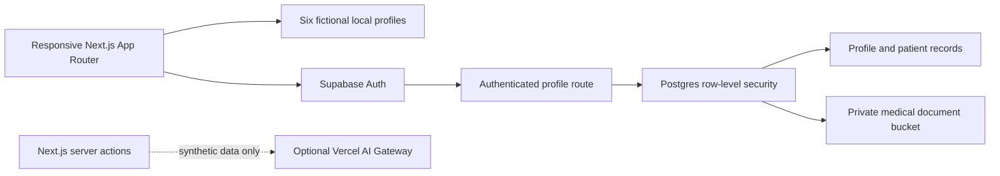

# MedVita architecture and delivery status

## Current application shape

The app is a presentation demo that runs without credentials. Stage switching moves among an infant, child, adolescent girl, adolescent boy, adult, and senior. The timed walkthrough is intended for presentations. Demo profiles are bundled in the client; local notes use browser storage, while uploaded filename samples stay in page memory. The AI summary action accepts only a stage identifier and uses server-defined fictional content. Without gateway configuration it returns an explicitly labeled static sample. Live provider calls require both server-side gateway configuration and a signed-in user. No real health data is sent to a provider.

The app uses Next.js App Router, strict TypeScript, Tailwind CSS, and Lucide icons. Supabase browser/server clients, a Next.js 16 `proxy.ts` session-refresh hook, and a PKCE callback route are configured for the dedicated `Med-Vita` Supabase project.

## Intended data and access boundaries

- `profiles` and `user_roles` are tied to authenticated Supabase users.
- A `patient_profile` is separate from an account. Access is through active `patient_relationships` with explicit read/write flags.
- Clinician access also requires an `access_permissions` row.
- Sensitive adolescent rows use `visibility = 'sensitive_adolescent'`; the draft RLS helper requires patient access or a matching active consent record. Guardian status alone is not intended to grant this scope.
- Medical documents use a private `medical-documents` bucket with patient-folder policies.
- OCR output is not a verified medical fact until a person reviews it.
- Synthetic presentation profiles are not inserted into patient tables.

The migrations are applied to the dedicated `Med-Vita` project (`udjcnvwvlxnmsiacbqpl`, `ap-south-1`). All 44 public tables have RLS enabled; the medical-document bucket is private. Infant and child profiles support structured feeding, bowel, vomiting, growth, urination, sleep, temperature, vaccination, and caregiver-entered developmental observations; pediatric vital access is restricted to temperature readings. Adult and senior profiles can save patient- or caregiver-reported condition notes, vital readings, self-assigned care tasks, medicine schedules, and dose-event logs; these remain unverified. The medical calendar uses profile-scoped appointments, event types, notes, month/week/day/agenda views, and an authenticated ICS export. Calendar and medicine schedules do not send reminders or provide prescription advice. Marking a medicine non-current attempts to pause active schedules; the UI reports when that update fails. Child caregiver entries do not generate vaccine schedules, developmental assessments, or reminders. After the security helper migration, the Supabase security advisor reported no findings. A transaction-based SQL suite checks 90 patient, guardian, clinician, sensitive-consent, export, timeline-write, symptom, infant/child care, milestone, adult/senior vital, adolescent cycle-journal, appointment, medication schedule/log, emergency contact/action, care-task, document-metadata, calendar-event, and profile-creation access cases with fictional fixture identities and rolls them back. The 90-case suite passed against the linked project on 2026-11-20.

## Delivery checklist

| Area | State | Notes |
|---|---|---|
| Accessible life-stage presentation demo | Implemented | Six profiles, keyboard tabs, timed walkthrough, larger text, contrast control |
| Demo interactions | Implemented | Local notes and age-aware care logs, medicine toggles, wellness checklist, appointment samples, fictional JSON export, synthetic AI summary with static fallback |
| Account and profile entry | Implemented (limited) | Email/password sign-in, sign-up, and reset; list RLS-visible profiles; create adult self-profile or submit a pending minor guardian request; download an RLS-filtered JSON export; add/view unverified RLS-protected timeline notes, infant/child feeding, bowel, vomiting, growth, urination, sleep, temperature, vaccination, and developmental observation records, adolescent sensitive cycle journal, adult/senior condition notes, vital readings, and self-assigned care tasks; create/read calendar events, medicine schedules, dose-event logs, and self-reported medicine notes with author-only detail and status edits; profile-scoped emergency summary, contact management, and user-entered alert log; upload/list supported private files |
| Supabase SSR client setup | Configured | Cookie-based clients, `proxy.ts`, and PKCE callback |
| Core database schema | Applied | Twelve migrations; patient, relationships, consent, clinical, medication, documents, calendar, wellness, AI, alerts, notifications, RLS-aware account export |
| Hosted database and RLS configuration | Applied | 44 public tables have RLS; private document bucket; calendar migrations add event metadata and an index; the latest migrations restrict medication-note updates to their authors and scope handover insertions to the author and linked reader |
| RLS access-isolation verification | Passing | 90 fictional role/consent/export/timeline/symptom/child-care/milestone/vital/adolescent-consent/appointment/medication/emergency-contact/emergency-action/care-task/handover/calendar cases run transactionally and roll back |
| Patient record management | Partial | RLS-protected timeline-note and symptom-observation create/read; infant/child feeding, bowel, vomiting, growth, urination, sleep, temperature, vaccination, and developmental observation create/read; adolescent sensitive cycle journal; adult/senior patient- or caregiver-reported condition notes, vital readings, and self-assigned care-task create/read/status update; calendar event create/read/update/delete with month/week/day/agenda views and ICS export; appointment status update; medicine schedule and dose-event create/read; self-reported medicine-note create/read/edit/status update by its author; medicine-note deletion remains unimplemented; generate, save, and download point-in-time caregiver handover snapshots using only general records, with author and linked-reader RLS checks; handovers do not alter access or send notifications; active schedules pause when a medicine is paused, discontinued, or moved to history; private PDF/JPG/PNG document upload/read up to 4 MB; add forms collapse into keyboard-accessible disclosures; timeline note detail edits/deletion, recurring events, notifications, growth percentiles, vaccine schedules and reminders, age-based milestone guidance and follow-up notifications, vital trends/charts, OCR, external clinic actions, automatic medication reminders/refill alerts, and caregiver invitations, permission transfer, and role-specific sharing workflows remain |
| Role-specific care workflows | Not implemented | Doctor, caregiver, clinic, and platform admin screens remain |
| AI/OCR/notifications/calendar integrations | Partial | Synthetic-only structured AI summary path via optional Vercel AI Gateway; provider credentials are not configured or live-verified. Real-record AI, OCR, reminders/notifications, and external calendar sync remain unimplemented; profile-scoped calendar UI and ICS export are available |
| Emergency assistance | Implemented as a device-assisted prototype | Authenticated profile medical summary, emergency-contact add/remove, user-entered emergency action history, manual `tel:` links, and explicit device location share; the presentation dashboard still uses fictional contacts. The app does not dispatch, auto-notify contacts, store location, or confirm calls. Regional number configuration and hardware integration remain |
| Local checks | Passing | TypeScript, lint, 85 tests across nine files (including synthetic AI summary, timeline, symptom, child-care, vaccination, developmental milestone, condition, care-task, vital, menstrual-journal, appointment create/edit/delete/status, calendar ICS export, medicine schedule, dose-log, medicine-note edit/status, emergency contact/alert actions, caregiver handover generation, and document-upload actions), production build |
| GitHub | Complete | Private `Arya99908/medvita-healthcare-platform`; credentials and patient records excluded |
| Vercel | Deployed | Protected production alias and preview; deployment protection requires Vercel team authentication |

## Required next work

1. Complete account deletion with identity re-verification, linked-record retention rules, and a reviewed administrative process.
2. Add authenticated health-event and medication CRUD with access checks and audit trails.
3. Implement reviewed role-specific workflows and permission management; keep sensitive adolescent access consent-based.
4. Add private file uploads, calendar and notification services, AI summaries, configured regional emergency services, emergency contact escalation, and caregiver handover notification/access-transfer as independently configured integrations.
5. Complete security, privacy, legal, and clinical review before any real-world use.
