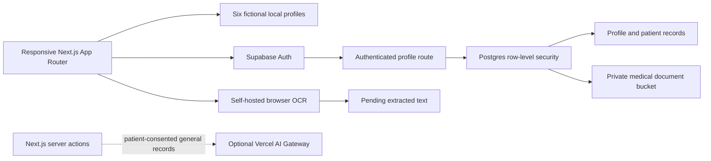

# MedVita architecture and delivery status

## Current application shape

The app is a presentation demo that runs without credentials. Stage switching moves among an infant, child, adolescent girl, adolescent boy, adult, and senior. The timed walkthrough is intended for presentations. Demo profiles are bundled in the client; local notes use browser storage, while uploaded filename samples stay in page memory. The demo AI summary action accepts only a stage identifier and uses server-defined fictional content. Without gateway configuration it returns an explicitly labeled static sample. The separate patient-history summary can send selected general records to a configured AI provider only after patient-account consent. OCR runs entirely in the browser using self-hosted assets; document bytes are not sent to an AI provider.

The app uses Next.js App Router, strict TypeScript, Tailwind CSS, and Lucide icons. Supabase browser/server clients, a Next.js 16 `proxy.ts` session-refresh hook, and a PKCE callback route are configured for the dedicated `Med-Vita` Supabase project.

## Intended data and access boundaries

- `profiles` and `user_roles` are tied to authenticated Supabase users.
- A `patient_profile` is separate from an account. Access is through active `patient_relationships` with explicit read/write flags.
- Clinician access also requires an `access_permissions` row.
- Sensitive adolescent rows use `visibility = 'sensitive_adolescent'`; the draft RLS helper requires patient access or a matching active consent record. Guardian status alone is not intended to grant this scope.
- Medical documents use a private `medical-documents` bucket with patient-folder policies.
- OCR output is not a verified medical fact until a person reviews it.
- Synthetic presentation profiles are not inserted into patient tables.

The migrations are applied to the dedicated `Med-Vita` project (`udjcnvwvlxnmsiacbqpl`, `ap-south-1`). All 48 public tables have RLS enabled; the medical-document bucket is private. Verified doctors can add append-only consultation, care-plan, follow-up, or addendum notes and AI-summary reviews when a patient grants separate note consent. Their access to general records stays read-only; note and read permissions expire after 90 days or earlier revocation. Infant and child profiles support structured feeding, bowel, vomiting, growth, urination, sleep, temperature, vaccination, and caregiver-entered developmental observations; pediatric vital access is restricted to temperature readings. Adult and senior profiles can save patient- or caregiver-reported condition notes, vital readings, care tasks assigned to the signed-in user or an active linked writable caregiver, medicine schedules, and dose-event logs; these remain unverified. A privacy-filtered caregiver activity feed records actor, event category, and time for record changes without copying record text; RLS applies the same sensitive-adolescent access rule to the feed, and historical events are not backfilled. A notification center delivers generic in-app alerts for task assignment, with a user preference to disable that category; email, SMS, push, scheduled reminders, and delivery retries are not configured. The medical calendar uses profile-scoped appointments, event types, notes, month/week/day/agenda views, and an authenticated ICS export. Calendar and medicine schedules do not send reminders or provide prescription advice. Marking a medicine non-current attempts to pause active schedules; the UI reports when that update fails. Child caregiver entries do not generate vaccine schedules, developmental assessments, or reminders. A previous Supabase security-advisor run reported no findings after the activity and task-notification migrations; it has not been rerun since the AI-summary and review migrations. The transaction-based SQL suite checks 146 role, consent, export, record-write, note, AI-review, wellness, and revocation cases with fictional fixture identities and rolls them back. It passed against the linked project on 2026-11-20, including clinician-note consent, append-only enforcement, patient-only AI consent, clinician review visibility, wellness-goal and log authorization, and consent revocation.

## Delivery checklist

| Area | State | Notes |
|---|---|---|
| Accessible life-stage presentation demo | Implemented | Six profiles, keyboard tabs, timed walkthrough, larger text, contrast control |
| Demo interactions | Implemented | Local notes and age-aware care logs, medicine toggles, wellness checklist, appointment samples, fictional JSON export, synthetic AI summary with static fallback |
| Account and profile entry | Implemented (limited) | Email/password sign-in, sign-up, and reset; list RLS-visible profiles; create adult self-profile or submit a pending minor guardian request; download an RLS-filtered JSON export; add/view unverified RLS-protected timeline notes, infant/child feeding, bowel, vomiting, growth, urination, sleep, temperature, vaccination, and developmental observation records, adolescent sensitive cycle journal, adult/senior condition notes, vital readings, and care tasks assigned to the signed-in user or an active linked writable caregiver; create/read calendar events, medicine schedules, dose-event logs, and self-reported medicine notes with author-only detail and status edits; profile-scoped emergency summary, contact management, and user-entered alert log; upload/list supported private files; adult/senior profile owner can create expiring one-use caregiver/family invites bound to a confirmed email (read-only by default, optional read/write), recipients explicitly accept, and profile owner can revoke active links and non-patient relationships |
| Supabase SSR client setup | Configured | Cookie-based clients, `proxy.ts`, and PKCE callback |
| Core database schema | Applied | Twenty-six migrations; patient, relationships, consent, clinical, medication, documents, calendar, wellness, AI, alerts, notifications, activity feed, clinician notes and addenda, RLS-aware account export |
| Hosted database and RLS configuration | Applied | 48 public tables have RLS; private document bucket; calendar migrations add event metadata and an index; later migrations restrict medication-note updates to their authors, scope handovers to the author and linked reader, add email-bound caregiver invitations accepted through single-use hashed tokens, add the privacy-filtered activity feed, enforce verified doctor and patient-consented clinician-note access, and restrict AI-processing consent to a short-lived patient-granted request, and append-only clinician AI-summary reviews gated by separate note consent |
| RLS access-isolation verification | Passing | 146 fictional role/consent/export/timeline/symptom/child-care/milestone/vital/adolescent-consent/appointment/medication/wellness/emergency-contact/emergency-action/care-task/handover/invitation/calendar/activity-feed/task-notification/clinician-note/AI-consent/AI-review cases run transactionally and roll back |
| Patient record management | Partial | RLS-protected timeline-note and symptom-observation create/read; infant/child feeding, bowel, vomiting, growth, urination, sleep, temperature, vaccination, and developmental observation create/read; adolescent sensitive cycle journal; adult/senior patient- or caregiver-reported condition notes, vital readings, and care-task create/read/status update with linked writable assignees; only assignee or creator can update or remove a task, and a task can be marked missed only after its due time; append-only privacy-filtered activity feed for new record changes; in-app notifications for task assignment with recipient-controlled preference; calendar event create/read/update/delete with month/week/day/agenda views and ICS export; appointment status update; searchable, life-stage-aware wellness education with source and limitation labels, saved patient-owned goals, profile-backed exercise/meal/water/habit logs, goal status changes, and calendar scheduling; no clinical targets or treatment recommendations; medicine schedule and dose-event create/read; self-reported medicine-note create/read/edit/status update by its author; append-only clinician-authored consultation, care-plan, follow-up, and addendum notes for verified doctors with separate patient-granted note permission; read-only general patient-record access, with no clinician edits to patient entries or prescription workflow; medicine-note deletion remains unimplemented; generate, save, and download point-in-time caregiver handover snapshots using only general records, with author and linked-reader RLS checks; handovers do not alter access or send notifications; create RLS-filtered 7/30/90/365-day patient health reports with measurement charts, symptom counts, medication-event summaries, sleep/feeding logs, wellness and activity counts, and PDF through browser print; each report shows source, date range, verification limits, and incomplete-data warnings; issue and revoke single-use, seven-day, email-bound adult/senior caregiver invitations; adult and senior patients can also invite a verified doctor for read-only access and separately consented clinician-note access, both expiring after 90 days; invited accounts must confirm email and accept before access begins; revoke active non-patient access relationships; active schedules pause when a medicine is paused, discontinued, or moved to history; private PDF/JPG/PNG document upload/read up to 4 MB; local English OCR for images and PDFs up to five pages, with labeled date/patient/medicine/lab/range/doctor/finding candidates that users can edit and review; candidate fields remain separate from medical records; add forms collapse into keyboard-accessible disclosures; timeline note detail edits/deletion, recurring events, notification services beyond task-assignment in-app alerts, growth percentiles, vaccine schedules and reminders, age-based milestone guidance and follow-up notifications, vital target interpretation, weekly/monthly wellness summaries, goal streaks and timed wellness reminders, physical-activity trend analysis, promotion of OCR candidates into structured medical records, document search and retention-aware deletion, external clinic actions, automatic medication reminders/refill alerts, and minor-profile guardian invitations, granular per-resource permissions, email delivery, invitation reminders, email/SMS/push notification delivery, scheduled reminders, notification retries, permission transfer, and role-specific clinic/admin write workflows remain |
| Patient analytics and reports | Partial | `/account/patients/[patientId]/reports` provides RLS-filtered rolling date ranges, weight/blood pressure/glucose charts, symptom counts, medication-event summaries, sleep/feeding trends, wellness and caregiver activity summaries, health events and appointment lists; reports can be printed or saved as PDF, with source/date range, verification notes and partial-data warnings. Regularity inference and unconfigured data-source analytics remain unavailable |
| Role-specific care workflows | Partial | Caregiver task dashboard at `/account/care` shows tasks assigned across readable profiles with open/completed/missed filters, and `/account/notifications` lists in-app care-task assignment alerts with an opt-out preference; adult and senior patients can invite a verified doctor by email for time-limited read-only general-record access and separately consented append-only clinician notes; `/account/doctor` and its patient case page show consent-filtered records, clinician-authored notes, patient-consented AI summaries and dated clinician review history. Doctor-initiated access requests, clinic, nursing, and platform admin workspaces remain |
| AI/OCR/notifications/calendar integrations | Partial | The presentation demo uses structured AI only with fictional input. Patient-owned profiles also have a one-time-consent, schema-validated server action that reads RLS-visible general records, excludes sensitive adolescent entries and file contents, stores date-bounded report/source links, and denies caregiver-initiated sharing. Patient-consented summaries can receive append-only review from verified clinicians with separate note consent. AI provider credentials are not configured or live-verified; longitudinal comparison, clinician-approved deterministic safety rules, promotion of OCR candidates into structured medical records, scheduled reminders, email/SMS/push delivery, and external calendar sync remain unimplemented; profile-scoped calendar UI and ICS export are available |
| Emergency assistance | Implemented as a device-assisted prototype | Authenticated profile medical summary, emergency-contact add/remove, user-entered emergency action history, manual `tel:` links, and explicit device location share; the presentation dashboard still uses fictional contacts. The app does not dispatch, auto-notify contacts, store location, or confirm calls. Regional number configuration and hardware integration remain |
| Local checks | Passing | TypeScript, lint, production build, 138 Vitest tests across twenty-three files, and 152 linked Supabase pgTAP RLS assertions including wellness-goal and log authorization, unverified OCR candidate storage/review access, verified-doctor gating, read-only invitations, separate note consent, 90-day expiry, append-only enforcement, export visibility, AI consent restrictions, AI-summary review visibility and consent revocation, general-record write denial, and revocation; the latest linked schema-lint retry could not authenticate the temporary database role, though the linked pgTAP suite passed |
| GitHub | Complete | Private `Arya99908/medvita-healthcare-platform`; credentials and patient records excluded |
| Vercel | Deployed | Protected production alias and preview; deployment protection requires Vercel team authentication |

## Required next work

1. Complete account deletion with identity re-verification, linked-record retention rules, and a reviewed administrative process.
2. Add authenticated health-event and medication CRUD with access checks and audit trails.
3. Implement reviewed role-specific workflows and permission management; keep sensitive adolescent access consent-based.
4. Add document search and retention-aware deletion; add calendar and notification services, configured regional emergency services, emergency contact escalation, and caregiver handover notification/access-transfer as independently configured integrations.
5. Complete security, privacy, legal, and clinical review before any real-world use.
