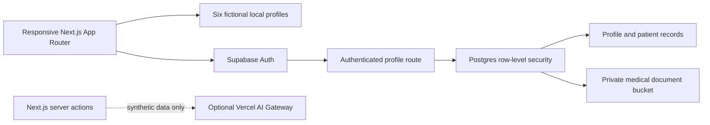

# MedVita architecture and delivery status

## Current application shape

The app is a presentation demo that runs without credentials. Stage switching moves among an infant, child, adolescent girl, adolescent boy, adult, and senior. The timed walkthrough is intended for presentations. Demo profiles are bundled in the client; local notes use browser storage, while uploaded filename samples stay in page memory. The AI summary action accepts only a stage identifier and uses server-defined fictional content. Without gateway configuration it returns an explicitly labeled static sample. Live provider calls require both server-side gateway configuration and a signed-in user. No real health data is sent to a provider.

The app uses Next.js App Router, strict TypeScript, Tailwind CSS, and Lucide icons. Supabase browser/server clients, a Next.js 16 `proxy.ts` session-refresh hook, and a PKCE callback route are configured for the dedicated `Med-Vita` Supabase project.

## Intended data and access boundaries

- `profiles` and `user_roles` are tied to authenticated Supabase users.
- A `patient_profile` is separate from an account. Access is through active `patient_relationships` with explicit read/write flags.
- Clinician access also requires an `access_permissions` row.
- Sensitive adolescent rows use `visibility = 'sensitive_adolescent'`; the draft RLS helper requires patient access or a matching active consent record. Guardian status alone is not intended to grant this scope.
- Medical documents use a private `medical-documents` bucket with patient-folder policies.
- OCR output is not a verified medical fact until a person reviews it.
- Synthetic presentation profiles are not inserted into patient tables.

The five migrations are applied to the dedicated `Med-Vita` project (`udjcnvwvlxnmsiacbqpl`, `ap-south-1`). All 40 public tables have RLS enabled; the medical-document bucket is private. After the security helper migration, the Supabase security advisor reported no findings. A transaction-based SQL suite checks 49 patient, guardian, clinician, sensitive-consent, export, timeline-write, symptom, infant/child feeding, bowel, vomiting, and growth logs, appointment-write/update, medication-write/update, profile-creation, and pending-guardian cases with fictional fixture identities and rolls them back. It was run through `supabase db query --linked`; the standard `supabase test db --linked` command still requires local Docker/Podman. `supabase db lint --linked` reports no schema errors.

## Delivery checklist

| Area | State | Notes |
|---|---|---|
| Accessible life-stage presentation demo | Implemented | Six profiles, keyboard tabs, timed walkthrough, larger text, contrast control |
| Demo interactions | Implemented | Local notes and age-aware care logs, medicine toggles, wellness checklist, appointment samples, fictional JSON export, synthetic AI summary with static fallback |
| Account and profile entry | Implemented (limited) | Email/password sign-in, sign-up, and reset; list RLS-visible profiles; create adult self-profile or submit a pending minor guardian request; download an RLS-filtered JSON export; add/view unverified RLS-protected timeline notes, infant/child feeding, bowel, vomiting, and growth records, appointment plans, and self-reported medicine notes; upload/list supported private files |
| Supabase SSR client setup | Configured | Cookie-based clients, `proxy.ts`, and PKCE callback |
| Core database schema | Applied | Five migrations; patient, relationships, consent, clinical, medication, documents, calendar, wellness, AI, alerts, notifications, RLS-aware account export |
| Hosted database and RLS configuration | Applied | 40 public tables have RLS; private document bucket; security advisor clear |
| RLS access-isolation verification | Passing | 49 fictional role/consent/export/timeline/symptom/child-care/appointment/medication/document-metadata cases run transactionally; standard `supabase test db --linked` still requires local Docker/Podman |
| Patient record management | Partial | RLS-protected timeline-note and symptom-observation create/read; infant/child feeding, bowel, vomiting, and growth-record create/read; appointment-plan create/read/status update; self-reported medicine-note create/read/current-past status update; private PDF/JPG/PNG document upload/read up to 4 MB; add forms collapse into keyboard-accessible disclosures; note detail edits, growth percentiles, OCR, external clinic actions, medication schedules/logs, and role sharing workflows remain |
| Role-specific care workflows | Not implemented | Doctor, caregiver, clinic, and platform admin screens remain |
| AI/OCR/notifications/calendar integrations | Partial | Synthetic-only structured AI summary path via optional Vercel AI Gateway; provider credentials are not configured or live-verified. Real-record AI, OCR, notifications, and calendar connections remain unimplemented |
| Emergency demo | Implemented locally | User-initiated `tel:` links and fictional quick-reference card; no contact alert, location sharing, dispatch, or call confirmation |
| Local checks | Passing | TypeScript, lint, 43 tests across six files (including synthetic AI summary, timeline, symptom, child-care, appointment, medicine-note, and document-upload actions), production build |
| GitHub | Complete | Private `Arya99908/medvita-healthcare-platform`; credentials and patient records excluded |
| Vercel | Deployed | Protected production alias and preview; deployment protection requires Vercel team authentication |

## Required next work

1. Complete account deletion with identity re-verification, linked-record retention rules, and a reviewed administrative process.
2. Add authenticated health-event and medication CRUD with access checks and audit trails.
3. Implement reviewed role-specific workflows and permission management; keep sensitive adolescent access consent-based.
4. Add private file uploads, calendar and notification services, AI summaries, and emergency handoff as independently configurable integrations.
5. Complete security, privacy, legal, and clinical review before any real-world use.
