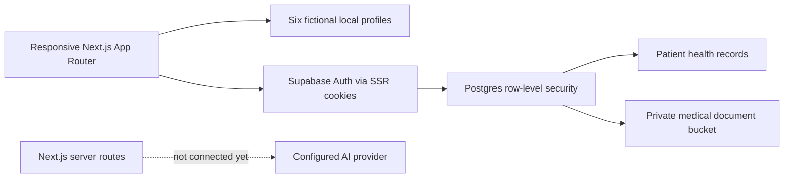

# MedVita architecture and delivery status

## Application shape

The browser demo is deliberately usable without accounts or secrets. Its fictional profiles and edits are separate from hosted patient data. Demo notes use local storage; selected file names remain in page memory, and no file contents leave the browser.

The application shell uses Next.js App Router, strict TypeScript, Tailwind CSS support, Lucide icons, and a small reusable UI layer. Supabase clients use the SSR cookie pattern: a browser client for client components, a request-scoped server client for server work, and the Next.js 16 `proxy.ts` convention for auth-session refresh.

## Data and access boundaries

- `profiles` and `user_roles` are tied to authenticated Supabase users.
- A `patient_profile` is not a user account. Access is through active `patient_relationships` with explicit read/write flags.
- Clinician access also requires an `access_permissions` row.
- Sensitive adolescent rows use `visibility = 'sensitive_adolescent'`; the RLS helper requires the patient relationship or a matching active consent record. Guardian status alone does not grant this scope.
- Medical documents use a private `medical-documents` bucket with patient-folder RLS policies.
- Uploaded data and extracted OCR fields remain unverified until reviewed.
- Synthetic sample data is not inserted into real patient tables.

The SQL migration is a reviewed draft and has **not** been applied to a live or local database. It must be exercised against a dedicated MedVita project and its RLS policies audited before using real records.

## Current delivery checklist

| Area | State | Notes |
|---|---|---|
| Accessible life-stage presentation demo | Implemented locally | Infant, child, teen girl, teen boy, adult, and senior; tabs, walkthrough, font and contrast controls |
| Demo interactions | Implemented locally | Local notes, sample medication toggles, wellness checklist, appointment demo, fictional report export |
| Account entry | Implemented locally | Email/password sign-in and sign-up UI; disabled until public Supabase URL/key are configured |
| Supabase SSR client setup | Prepared | Cookie-based server/client clients and `proxy.ts`; not connected to a project |
| Core database schema | Drafted | Patient, relationship, consent, clinical, medication, document, calendar, wellness, AI-report, alert, and notification tables |
| Synthetic database seeding | Deferred | Demo data stays local until isolated demo accounts can be designed and tested |
| Live CRUD and patient invitations | Not implemented | Needs a dedicated project and end-to-end authorization tests |
| AI, OCR, notifications, calendar, emergency escalation | Not implemented | Provider credentials and reviewed clinical/privacy rules are missing |
| Doctor, caregiver, clinic-admin workflows | Not implemented | Role records are modeled; role-specific screens and audited admin paths remain |
| Local quality checks | Passing | TypeScript, ESLint, four UI tests, and optimized Next.js build |
| Database/RLS validation | Blocked | No Docker daemon; no active dedicated MedVita project selected |
| GitHub and Vercel delivery | Not completed | Account connections verified; repository and deployment are not created |

## Next implementation steps

1. Select or create a dedicated active Supabase project and configure its credentials outside source control.
2. Apply and test the schema; add isolated test identities for RLS/access isolation.
3. Add authenticated patient/profile CRUD with server-side checks and audit trails.
4. Implement clinician/guardian/caregiver access and consent workflows before sensitive adolescent records.
5. Add document upload, calendar, notifications, and reviewable AI summaries as separately configured integrations.
6. Create a private repository and deployment only after the code and selected project have been reviewed.
